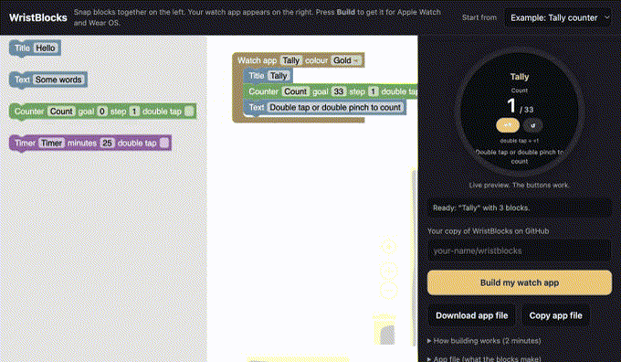

# WristBlocks

**Make your own smartwatch app by snapping blocks together. One app, built for Apple Watch and Wear OS. No Mac, no Xcode, no Android Studio.**



[**Open the editor**](https://tuple-labs.github.io/wristblocks/) · [Download the example apps](../../releases) · [Install on Apple Watch](docs/install-apple-watch.md) · [Install on Wear OS](docs/install-wear-os.md)

---

## Make your first watch app (no coding)

You need a free GitHub account. That's it.

1. **Copy WristBlocks:** press **Fork** at the top of this page.
2. **Turn on building:** in your copy, open the **Actions** tab and press the green button.
3. **Design your app:** open the [editor](https://tuple-labs.github.io/wristblocks/), drag blocks into the *Watch app* block and watch the preview update.
4. **Build:** type your copy's name (like `your-name/wristblocks`) and press **Build my watch app**. GitHub opens with your app file ready; press **Commit changes**.
5. **Download:** about 10 minutes later your app appears under **Releases** in your copy:
   - `yourapp-wearos.apk` for Pixel Watch, Galaxy Watch and other Wear OS watches
   - `yourapp-applewatch-unsigned.zip` for Apple Watch, plus a screenshot from Apple's watch simulator
6. **Install:** follow [Wear OS](docs/install-wear-os.md) or [Apple Watch](docs/install-apple-watch.md).

## Blocks

| Block | What it does | Hands free |
|---|---|---|
| **Title** | Big coloured heading | |
| **Text** | Small grey text, for hints | |
| **Counter** | A number that goes up when tapped, with an optional goal ring and rounds | Double tap (Apple Watch) / double pinch (Pixel Watch) adds one |
| **Timer** | Countdown with a buzz at the end | Double tap / double pinch starts and pauses |

Ideas people have built: a tally counter, a water tracker, a focus timer, a workout rep counter. Want a new block? See [Contributing](CONTRIBUTING.md).

## How it works

```
 editor (blocks)  ──►  apps/<name>.json  ──►  GitHub Actions
                                              ├─ Linux machine  ─► Wear OS app (.apk)
                                              └─ macOS machine  ─► Apple Watch app (.app) + simulator screenshot
```

- The blocks become a small **app file** ([format](docs/app-format.md)), checked by [`tools/validate.py`](tools/validate.py) before anything is built.
- One **runtime per watch** draws whatever the app file describes: [`runtime/apple`](runtime/apple) (SwiftUI) and [`runtime/wearos`](runtime/wearos) (Kotlin, Compose for Wear OS).
- **Apple Watch apps are built on GitHub's Macs** (free for public repositories), so this works from Windows, Linux or macOS and stays within Apple's terms. Builds are unsigned; you sign on your own device, so no Apple ID ever touches GitHub.

## Build on your own computer (Docker)

Prefer not to use GitHub's machines for Wear OS? Run everything locally:

```bash
docker compose up                                   # editor on http://localhost:8080
docker compose run --rm box build apps/tally.json   # writes out/tally-wearos.apk
docker compose run --rm box pair 192.168.1.20:41234 123456      # once, codes from the watch
docker compose run --rm box install out/tally-wearos.apk 192.168.1.20:37001
```

The Apple Watch version always builds on GitHub's Macs (Apple's tools only run on macOS).

## What's next

- [x] Apple Watch and Wear OS from one app file
- [x] Blocks editor with live preview
- [x] Docker box for local Wear OS builds and installs
- [ ] More blocks: heart rate, steps, send to a web link, complications on the watch face
- [ ] One-click Apple Watch install helper (free Apple ID)
- [ ] Garmin Connect IQ

## Contributing

Testing on real watches is the most useful help right now. See [CONTRIBUTING.md](CONTRIBUTING.md).

## License

MIT. Built with [Blockly](https://github.com/google/blockly), [XcodeGen](https://github.com/yonaskolb/XcodeGen) and Compose for Wear OS.
